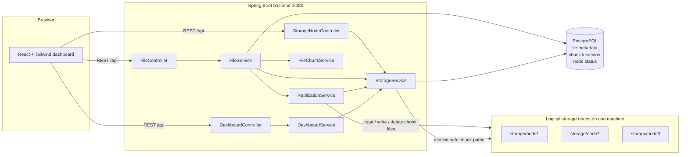
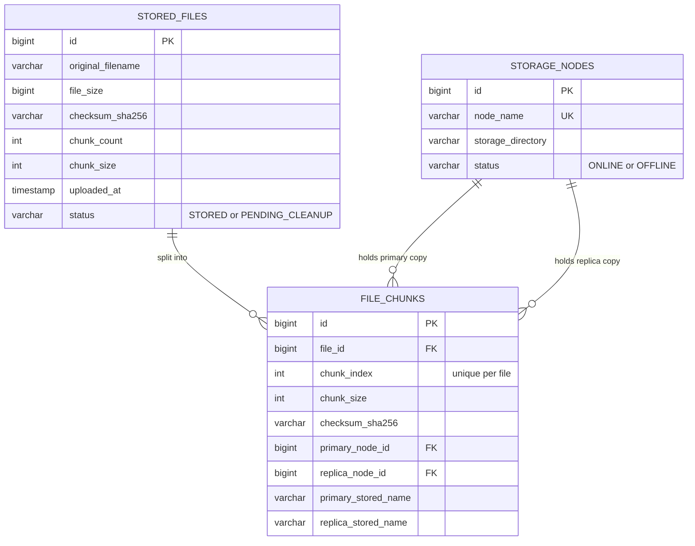

# Distributed File Storage System

A beginner-friendly web app that splits uploaded files into 1 MiB chunks, spreads those chunks across three storage nodes, keeps a backup copy of every chunk on a different node, and rebuilds the original file on download. It is built to be **understood, run, and explained** in a college project demo or viva, not to be a production distributed system.

---

## 1. Problem Statement

A single disk is a single point of failure. If the disk dies, the files on it are gone. Large-scale systems solve this by splitting data and storing copies on several machines. Learning how that works usually means reading dense papers. This project shows the core ideas in a small, working, inspectable system.

## 2. Project Objectives

- Split files into fixed-size chunks and store them across several nodes.
- Keep a replica (backup copy) of every chunk on a different node.
- Detect corruption with SHA-256 checksums, both per chunk and for the whole file.
- Keep working when a node is unavailable by reading from replicas.
- Provide a dashboard that shows real data from the backend.

## 3. Features

| Feature | What it does |
|---|---|
| File upload | Drag-and-drop or browse; real upload progress; chunking, checksums, replication |
| File manager | Table of files with search, download, verify, delete, and status badges |
| Download | Rebuilds the file from chunks, falling back to replicas, and checks the overall SHA-256 before sending |
| Storage node dashboard | Three node cards with online/offline status, chunk counts, primary vs replica counts, and storage used |
| Failure simulation | Mark a node OFFLINE (persisted in PostgreSQL) to simulate a failure, then bring it back |
| Integrity verification | Re-reads every copy, compares checksums, and reports VERIFIED, CORRUPTED, or UNAVAILABLE |
| Delete | Removes all primary and replica chunk files and metadata; reports partial failures safely |
| Dashboard | Totals, storage usage chart, primary vs replica chart, recent uploads |

> **Important:** the three storage nodes are **logical** nodes. They are three folders (`storage/node1`, `node2`, `node3`) managed by **one** Spring Boot application on **one** machine. They are not independent physical servers. "Node failure" is a software flag that makes the backend treat a node's files as unreachable. It is not a real network partition.

## 4. Architecture



Layers: **controllers** (HTTP in and out) → **services** (business logic) → **repositories** (Spring Data JPA) → **PostgreSQL**. Chunk bytes live on disk; only metadata lives in the database.

## 5. Technology Stack

- **Backend:** Java 21, Spring Boot 3.3, Spring Web, Spring Data JPA (Hibernate), Maven
- **Database:** PostgreSQL 16
- **Frontend:** React 18, Vite 5, Tailwind CSS 3 (JavaScript, no UI framework)
- **Deployment:** Docker, Docker Compose, nginx (serves the frontend and proxies `/api`)
- **Tests:** JUnit 5, Spring MockMvc, H2 in-memory database (tests only)

## 6. Database Design



Design notes for the viva:

- `file_chunks` has a **unique constraint** on `(file_id, chunk_index)`, so a file cannot have two chunks with the same position.
- Indexes on `original_filename` and `uploaded_at` speed up search and the "recent uploads" list. Indexes on the node foreign keys speed up per-node counts.
- Node **chunk counts and byte totals are not stored**. They are calculated from `file_chunks` every time, so they can never drift out of sync with the real data.
- Schema is created by Hibernate (`ddl-auto=update`). Tables are created on first startup.

## 7. Upload Workflow

1. The browser sends the file to `POST /api/files/upload` (multipart). The browser shows progress as bytes are sent.
2. The backend checks the file is not empty and that **at least two nodes are online**. Replication needs two nodes, so an upload is refused with HTTP 503 otherwise.
3. The file is read as a stream, **1 MiB at a time**. For each chunk:
   - a SHA-256 checksum of the chunk is calculated;
   - the whole-file SHA-256 is updated as well;
   - the chunk is placed on an **online** node (round-robin), and its **replica** goes to the next online node;
   - both copies are written with **generated UUID filenames** (`3f2c…-….chunk`). The user's filename is never used in a path.
4. When all chunks are written, the metadata is saved in one database transaction.
5. If anything fails, every chunk file written so far is deleted, so no orphan files are left behind.

## 8. Download Workflow

1. `GET /api/files/{id}/download` loads the file metadata and its chunks in order.
2. For each chunk, the backend reads the **primary** copy. If the primary node is offline, the file is missing, or its checksum does not match, it reads the **replica** instead.
3. If neither copy is readable, the request fails with HTTP 503 and names the chunk.
4. The chunks are written to a temporary file while the whole-file SHA-256 is recalculated.
5. If the rebuilt file's checksum does not match the original, the download is aborted with HTTP 500. **Bad data is never sent to the browser.**
6. Otherwise the file is streamed with `Content-Disposition: attachment`, and the temporary file is deleted when the stream closes.

## 9. Replication Explanation

- **Replication factor = 2.** Every chunk exists on exactly two different nodes: a **primary** and a **replica**.
- **Round-robin placement:** with nodes `[node1, node2, node3]` online, chunk 0 goes to node1 (replica node2), chunk 1 to node2 (replica node3), chunk 2 to node3 (replica node1), and so on. The starting node rotates between uploads so that small files are spread out too.
- **Offline nodes are skipped.** New uploads only use online nodes.
- **Why a replica is never on the same node:** with at least two online nodes, the "next node in rotation" is always a different node. The upload code refuses to run with fewer than two.
- **Survival:** with replication factor 2, any single node can be offline and every chunk can still be read.

Example with a 3-chunk file on three online nodes:

| Chunk | Primary | Replica |
|---|---|---|
| 0 | node1 | node2 |
| 1 | node2 | node3 |
| 2 | node3 | node1 |

## 10. Folder Structure

```
distributed-file-storage/
├── backend/                         Spring Boot application (Maven)
│   ├── pom.xml
│   ├── Dockerfile
│   ├── src/main/java/com/example/dfs/
│   │   ├── controller/              REST endpoints (files, nodes, dashboard)
│   │   ├── service/                 Business logic (upload, download, replication, nodes)
│   │   ├── repository/              Spring Data JPA interfaces
│   │   ├── entity/                  JPA entities (StoredFile, FileChunk, StorageNode)
│   │   ├── dto/                     Response records returned by the API
│   │   ├── exception/               Custom exceptions and the global error handler
│   │   ├── config/                  Settings binding and startup initializer
│   │   └── util/                    SHA-256 helper
│   ├── src/main/resources/application.yml
│   └── src/test/                    Unit and integration tests
├── frontend/                        React + Vite + Tailwind dashboard
│   ├── src/components/              Reusable UI pieces (table, cards, charts, dialogs)
│   ├── src/pages/                   Overview, File Manager, Storage Nodes
│   ├── src/services/api.js          All backend calls
│   ├── Dockerfile                   Builds the app and serves it with nginx
│   └── nginx.conf                   Serves files and proxies /api to the backend
├── storage/
│   ├── node1/                       Chunk files for logical node 1
│   ├── node2/                       Chunk files for logical node 2
│   └── node3/                       Chunk files for logical node 3
├── scripts/
│   ├── smoke-test.sh                End-to-end test against a running backend
│   └── sample.txt                   Small file for manual testing
├── docker-compose.yml
├── .env.example
├── .gitignore
└── README.md
```

## 11. Installation

### Option A: Docker (recommended)

Prerequisites: Docker with Compose v2.

```bash
cp .env.example .env          # then edit POSTGRES_PASSWORD if you like
docker compose up --build -d
```

Open **http://localhost:5173** for the dashboard. The API is at **http://localhost:8080/api**.

Stop everything with `docker compose down`. Chunk files stay in `./storage` because it is mounted as a volume. Use `docker compose down -v` to also delete the database volume.

### Option B: Run locally without Docker

Prerequisites: Java 21, Maven 3.9+, Node.js 20+, a running PostgreSQL 16.

1. **Create the database** (any method works), for example:
   ```sql
   CREATE USER dfs WITH PASSWORD 'dfs_password';
   CREATE DATABASE dfs OWNER dfs;
   ```
2. **Start the backend** from the `backend/` folder:
   ```bash
   cd backend
   mvn spring-boot:run
   ```
   Defaults connect to `jdbc:postgresql://localhost:5432/dfs` with user `dfs` and password `dfs_password`. Override with environment variables (see section 12). Chunk folders go to `../storage/node1..3`.
3. **Start the frontend** in a second terminal:
   ```bash
   cd frontend
   npm install
   npm run dev
   ```
   Open **http://localhost:5173**. Vite forwards `/api` requests to `http://localhost:8080`.

## 12. Environment Variables

| Variable | Default | Used by | Purpose |
|---|---|---|---|
| `POSTGRES_DB` | `dfs` | Compose | Database name |
| `POSTGRES_USER` | `dfs` | Compose | Database user |
| `POSTGRES_PASSWORD` | `dfs_password` | Compose | Database password (**change it**) |
| `DB_URL` | `jdbc:postgresql://localhost:5432/dfs` | Backend (local) | JDBC URL; Compose sets this to the `postgres` container |
| `DB_USERNAME` | `dfs` | Backend | Database user |
| `DB_PASSWORD` | `dfs_password` | Backend | Database password |
| `STORAGE_ROOT` | `../storage` | Backend | Folder that contains `node1/`, `node2/`, `node3/` |
| `CHUNK_SIZE_BYTES` | `1048576` (1 MiB) | Backend | Chunk size for new uploads |
| `MAX_UPLOAD_SIZE` | `200MB` | Backend | Largest accepted upload |
| `SERVER_PORT` | `8080` | Backend | HTTP port |
| `BACKEND_PORT` / `FRONTEND_PORT` | `8080` / `5173` | Compose | Host ports |
| `BACKEND_URL` | `http://localhost:8080` | Vite (dev) | Where the dev server forwards `/api` |

Replication factor is fixed at 2 and the node names are set in `application.yml` (`app.storage.node-names`).

## 13. API Endpoints

All responses are JSON. Errors look like this:

```json
{ "timestamp": "2026-10-11T10:15:30Z", "status": 404, "error": "Not Found", "message": "File 9 was not found.", "path": "/api/files/9" }
```

| Method | Path | Purpose | Success | Common errors |
|---|---|---|---|---|
| POST | `/api/files/upload` | Upload a file (multipart field `file`) | 201 | 400 empty file, 413 too large, 503 fewer than 2 nodes online |
| GET | `/api/files?search=` | List files, optional name search | 200 | |
| GET | `/api/files/{id}` | File metadata and chunk list | 200 | 404 |
| GET | `/api/files/{id}/download` | Download the rebuilt file | 200 | 404, 503 chunk unavailable |
| DELETE | `/api/files/{id}` | Delete a file and all its copies | 200 (deleted) / 409 (pending cleanup) | 404 |
| POST | `/api/files/{id}/verify` | Integrity check of every copy | 200 | 404 |
| GET | `/api/nodes` | All nodes with usage counts | 200 | |
| GET | `/api/nodes/{id}` | One node | 200 | 404 |
| POST | `/api/nodes/{id}/offline` | Simulate failure | 200 | 404 |
| POST | `/api/nodes/{id}/online` | Restore node | 200 | 404 |
| GET | `/api/dashboard/stats` | Totals and recent uploads | 200 | |

**Integrity statuses:** `VERIFIED` (every chunk matches and the rebuilt file matches the original SHA-256), `CORRUPTED` (a stored copy failed its checksum, or the rebuilt file does not match), `UNAVAILABLE` (some chunk has no readable copy). Each chunk also shows `VERIFIED`, `DEGRADED` (one good copy), `CORRUPTED`, or `UNAVAILABLE`. A corrupted copy always makes the file `CORRUPTED`, even when the replica saves the data, so corruption is never hidden.

## 14. Testing

Run the backend tests:

```bash
cd backend
mvn test
```

The tests cover:

- **Chunking:** chunk count, last-chunk size, split and reassemble (`FileChunkServiceTest`)
- **SHA-256:** known test vectors (`ChecksumUtilTest`)
- **Upload and download:** byte-for-byte round trip (`FileApiIntegrationTest`)
- **Placement:** primary and replica always on different nodes; offline nodes not used for new uploads
- **Replica fallback:** download still works with a node offline
- **Integrity:** a tampered primary chunk is reported as `CORRUPTED` and the download is still correct
- **Delete:** chunk files and metadata removed; partial deletes marked `PENDING_CLEANUP`
- **Node availability:** offline/online endpoints persist the status
- **Errors:** upload with fewer than two nodes, empty upload

The tests use an in-memory H2 database and a temporary storage folder (`backend/target/test-storage`), so they do not touch your PostgreSQL data or `storage/`.

Run the end-to-end smoke test against a running app (Docker or local):

```bash
./scripts/smoke-test.sh                       # uses http://localhost:8080
BASE_URL=http://localhost:8080 ./scripts/smoke-test.sh
```

It uploads a 2.5 MiB random file, checks it, downloads it, simulates a node failure, downloads again from replicas, restores the node, and deletes the file.

## 15. Demo Instructions

1. Start the app (`docker compose up --build -d`) and open http://localhost:5173.
2. **Overview:** point out the cards and charts. They are calculated from the database, and there is no fake data.
3. **File Manager:** drag `scripts/sample.txt` (or any file over 1 MiB) into the upload area. Watch the progress bar.
4. Click the file name to open **File Details**. Show the chunks, checksums, and the primary and replica node for each chunk.
5. Click **Verify** to get `VERIFIED`.
6. Open **Storage Nodes**. Click **Simulate failure** on `node1`. Its node card turns red.
7. Go back to the File Manager and click **Download**. The download still works, served from replicas.
8. Run **Verify** again and see the `DEGRADED` chunks and the warnings about node1.
9. Click **Restore node**.
10. Optional: look inside `storage/node1/`, `node2/`, `node3/`. Each chunk is a file with a UUID name, not the original filename.
11. Delete the file. Its chunk files disappear from all three folders.

## 16. Viva Questions and Short Answers

- **Why split files into chunks?** It lets large files be spread across several nodes, and a copy of a small piece is cheaper to move and check than a whole file.
- **Why SHA-256?** It is a fingerprint. Any change to the bytes changes the hash, so corruption can be detected. Chunk checksums locate the damaged part, and the whole-file checksum confirms the rebuilt result.
- **What is a replica and why not on the same node?** A replica is a second copy. If both copies were on one node, one node failure would lose the data.
- **What happens if a node fails?** Its copies become unreadable. Downloads and verification use the other copy of each chunk, because the two copies are always on different nodes.
- **Why are the nodes "logical"?** All three run inside one application on one machine. This is good for learning but gives no real hardware fault tolerance.
- **Why use filenames like UUIDs on disk?** User filenames can contain `../` or other characters that could write outside the storage folder. Generated names are always safe, and the path is still checked before use.
- **Why rebuild to a temp file before sending?** So the checksum of the whole file is confirmed before any byte reaches the browser.
- **Why is `PENDING_CLEANUP` needed?** A delete can fail partway, for example when a node is offline. Keeping the metadata lets the user retry once the node is back.

## 17. Known Limitations

- **Not a real distributed system.** Nodes are folders on one machine. There is no network, no independent failure, and no hardware redundancy.
- **Failure is simulated** by a database flag. Nothing actually breaks.
- **No automatic repair.** If a copy is lost or corrupted, the system reports it but does not rebuild it. The file stays degraded until it is deleted and uploaded again.
- **Replication factor is fixed at 2.** It cannot be changed without code changes.
- **Whole chunks are read into memory** (1 MiB each). Very large chunk sizes would use more memory.
- **Downloads are rebuilt in a temp file** on the backend's disk before they are sent. A very large file needs free disk space equal to its size.
- **Partial deletes** can leave chunks that cannot be read until the offline node returns. The file shows `PENDING_CLEANUP` and must be deleted again. Deleting a file that is pending cleanup is the only way to remove its metadata.
- **No authentication or access control.** Anyone who can reach the app can read, change, or delete files.
- **Upload is buffered per chunk, not streamed to the browser.** Progress shows bytes sent to the backend, not the time to finish saving.
- **Schema changes** are applied by Hibernate's `update` mode. There is no migration tool.
- **Node counts** are calculated on each request, which is fine for a few thousand chunks but would need caching at larger scale.

## 18. Future Enhancements

- Authentication and per-user file ownership
- Background repair that re-creates a missing or corrupted replica on a healthy node
- Configurable replication factor (3 or more copies)
- Streaming downloads without a temp file
- Flyway database migrations
- Real separate nodes (for example, small HTTP services per node) to learn about network failures
- Chunk size and placement policies chosen by the user
- Metrics and charts over time

## 19. Troubleshooting

- **"At least two storage nodes must be online"** on upload: restore a node from the Storage Nodes page.
- **Backend cannot connect to the database:** check `DB_URL`, the user, and the password. With Docker, wait for the `postgres` health check or run `docker compose logs postgres`.
- **Port already in use:** change `BACKEND_PORT` or `FRONTEND_PORT` in `.env`.
- **Upload rejected as too large:** raise `MAX_UPLOAD_SIZE`, and for Docker also keep `client_max_body_size` in `frontend/nginx.conf` above it.
